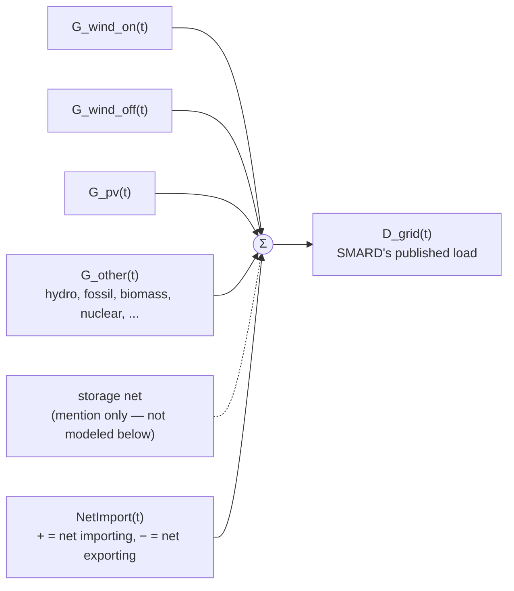
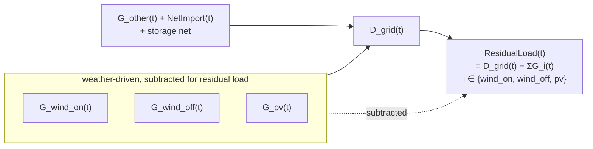
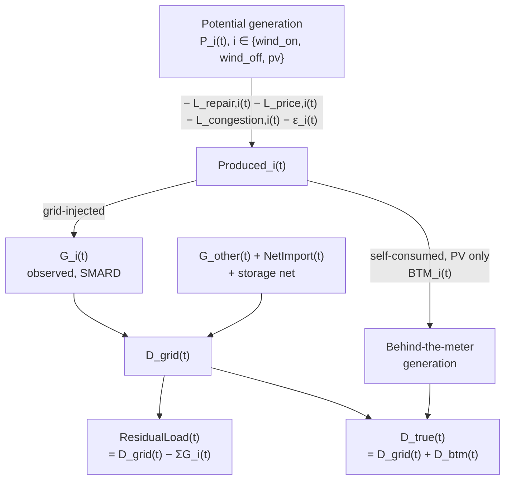

# Foundations: from grid demand to residual load

This chapter is self-contained: every symbol is defined where it first
appears, and nothing here depends on having read anything else in this
book. It builds up, step by step, one growing diagram of how Germany's
electricity system fits together — starting from the one number everyone
already has an intuition for (how much power the grid delivers) and
ending at the quantity this project actually wants to forecast:
**residual load**, the part of demand that has to be met by dispatchable
generation once weather-driven renewables have done what they can.

The notation matches `pecdr/residual_load.py` and the more exhaustive
[equations reference page](curtailment_system_equations.md) one-for-one,
so nothing has to be relearned if you already know those — but nothing
here assumes you do. Where this chapter simplifies or omits something
the reference page covers in full (behind-the-meter battery dynamics,
the feed-in-category split, a dead-end derivation worth knowing about),
it says so and points there.

## Step 1: what the grid actually sees — a balance, not a model

Start with the one quantity that's simply *measured*, not estimated:
`D_grid(t)`, SMARD's published grid load at hour `t` — how much power
was drawn from the German public grid. Every megawatt of it has to come
from somewhere: wind onshore, wind offshore, solar PV, or everything
else (hydro, fossil, biomass, nuclear until 2023, geothermal — grouped
here as `G_other(t)`, since this project doesn't model a weather-driven
"potential" for any of it), plus whatever crosses the border.

$$
D_{grid}(t) = G_{wind\_on}(t) + G_{wind\_off}(t) + G_{pv}(t) + G_{other}(t) + \big(G_{storage,discharge}(t) - G_{storage,charge}(t)\big) + NetImport(t)
$$



This is an accounting identity, true by construction — nothing here is
estimated or forecast, it's just bookkeeping. It also settles a question
that's easy to get tangled in: does exporting power count as part of
"demand"? No — `NetImport(t)` is signed. When Germany is a net exporter,
`NetImport(t) < 0`, and the identity says domestic generation has to cover
*both* `D_grid(t)` *and* the amount leaving the country. Export doesn't
split `D_grid(t)`'s stacked bar; it sits on the generation side of the
same balance, as a negative import.

Grid-scale storage (pumped hydro, increasingly grid batteries) is real
and already in this identity, but genuinely just mentioned here — not
pulled into anything that follows.

## Step 2: residual load — one specific way of splitting that sum

Of the terms in Step 1's identity, three are **weather-driven and
variable**: wind onshore, wind offshore, and PV. Their output depends on
what the weather happens to be doing, not on a dispatch decision. Everything
in `G_other(t)` — plus imports — is treated in this project as
**dispatchable**: available more or less on demand, within its own
constraints, and (for domestic fossil generation specifically) what
actually sets the price in a merit-order market.

**Residual load** is defined as what's left of grid demand once those
three weather-driven technologies are subtracted:

$$
ResidualLoad(t) = D_{grid}(t) - \big(G_{wind\_on}(t) + G_{wind\_off}(t) + G_{pv}(t)\big)
$$



**This is a scope decision worth naming, not hiding.** Hydro is
partly weather-driven too (run-of-river especially), and PECD does
publish hydro capacity factors — this project just doesn't currently
model hydro potential or subtract it here. It's grouped into `G_other(t)`
alongside genuinely dispatchable fossil and biomass generation. That's a
reasonable simplification (German hydro is a small share of the mix, and
much of it — reservoir and pumped storage — really is dispatchable), but
it means "residual load" here is narrower than "load minus all
renewables"; it's specifically "load minus the two technologies this
project models a weather-driven potential for."

## Step 3: what's actually invisible — behind-the-meter, on both sides

`D_grid(t)` and every `G_i(t)` above are net of something neither side
publishes: **behind-the-meter (BTM) self-consumption** — power generated
and used locally, never touching the public grid. It's asymmetric across
technologies: Germany's wind fleet is essentially 100% utility-scale and
always grid-connected, so `BTM_{wind\_on}(t) ≈ BTM_{wind\_off}(t) ≈ 0`
structurally. PV is different — MaStR (Germany's public plant register)
splits PV capacity into a `full_feed_in` category (required to export
100%, no self-consumption possible by regulation) and self-consumption
categories, and BTM is concentrated in the latter — measured from the
registry, not assumed, and it skews toward smaller rooftop installations
rather than utility-scale plants.

What's physically produced splits into what reaches the grid and what's
used behind the meter:

$$
Produced_i(t) = G_i(t) + BTM_i(t)
$$

And on the demand side, the mirror image: grid-metered demand plus the
invisible BTM demand met by local self-consumption is **gross demand**,
never directly observed:

$$
D_{true}(t) = D_{grid}(t) + D_{btm}(t)
$$

(`BTM_pv(t)` can also be time-shifted through a paired rooftop battery —
same-hour self-use plus battery discharge minus battery charge, with its
own state-of-charge recursion. Real, and mentioned for completeness, but
not modeled anywhere below; see the
[equations reference page](curtailment_system_equations.md#notation) for
the full battery notation if needed.)

Putting the whole thing together — potential generation splitting into
losses (next step) and what's produced, produced splitting into grid and
behind-the-meter, and `D_grid(t)` (from Step 1's balance) sitting
alongside gross demand:



This is the full structural picture the rest of this chapter fills in.
Read it left to right: potential splits into loss streams and what's
actually produced; produced splits again into grid-injected and
behind-the-meter; the behind-the-meter piece reappears on the demand
side, combining with `D_grid(t)` into gross demand `D_true(t)`.
`ResidualLoad(t)` only ever touches the *grid* boxes — which is exactly
why `BTM` turns out to cancel out of it (Step 9), even though it still
has to be modeled correctly to get `D_true(t)` right along the way
(Step 6).

## Step 4: why bother modeling any of this at all

Everything in the diagram above except `P_i(t)`, the loss terms, `BTM`,
and `D_true(t)` is something SMARD already publishes. `ResidualLoad(t)`
itself can be computed today, directly, from already-published numbers —
no modeling needed, just Step 2's subtraction.

The reason to go further is that the actual goal is a **day-ahead
forecast** of residual load — tomorrow's number, before SMARD has
published anything for tomorrow. And the already-published quantities
are exactly the ones you *can't* forecast directly from weather and
calendar, because they're already contaminated by things that haven't
happened yet from a forecaster's point of view: `G_i(t)` is already net
of curtailment nobody has decided on yet, and `D_grid(t)` is already net
of self-consumption that depends on tomorrow's cloud cover. What
*can* be forecast from weather and calendar are the underlying physical
and behavioral quantities: `P_i(t)` (what the fleet would produce, given
a weather forecast) and `D_true(t)` (what people and industry actually
want to consume, given a calendar and a temperature forecast). The next
few steps build both.

## Step 5: potential generation — what the fleet would produce, absent any losses

`P_i(t)` is this project's own modeled, weather-driven technical
potential for technology `i ∈ {wind_on, wind_off, pv}` — what the
installed fleet would generate given the weather, before any real-world
loss. It's built from ERA5 reanalysis weather (bias-corrected against the
Global Wind Atlas for wind, extrapolated to each turbine's hub height)
and MaStR's own record of which plants exist, where, and of what type —
the same replication effort documented in this book's wind and solar
workstreams, cross-checked against PECD's own published capacity factors
at every step. `P_total(t) = P_{wind\_on}(t) + P_{wind\_off}(t) + P_{pv}(t)`.

Potential splits into real-world losses plus whatever's actually
produced (plus this project's own model error, kept separate on
principle even though it's empirically indistinguishable from real
losses without independent validation):

$$
P_i(t) = L_{repair,i}(t) + L_{price,i}(t) + L_{congestion,i}(t) + Produced_i(t) + \varepsilon_i(t)
$$

- **`L_repair,i(t)`** — technical unavailability: storm damage, cable
  faults, scheduled maintenance. Independent of price or grid signals.
- **`L_price,i(t)`** — voluntary curtailment during negative prices. Not
  a grid-operator order, and not in any published redispatch dataset.
- **`L_congestion,i(t)`** — grid-operator-enforced curtailment
  (Redispatch 2.0 / Einspeisemanagement). The one loss category with
  published official data — but only from October 2021, and even then
  only monthly and national-only (see
  [notebook 44](../notebooks/44_analyse_congestion_curtailment.ipynb) for what
  that data does and doesn't cover).

Looking at the gap between potential and observed generation directly is
the first evidence this isn't just bookkeeping:

```{figure} ../../output/images/41_wind_offshore_potential_vs_observed.png
:name: fig-found-wind-gap
Wind offshore, Nov-Dec 2023: potential vs. observed (SMARD). No behind-the-meter term to blur the picture, so this gap is (almost) entirely loss.
```

Checked directly against real curtailment and price data in
[notebook 48](../notebooks/48_analyse_offshore_gap_vs_curtailment.ipynb):
`L_congestion` explains only ~40% of this gap on average, and `L_price` is
a real but modest contributor on top of that — not nearly all of it
either. The rest is more likely bias in this project's own "potential"
replication (the `ε_i(t)` term above) than an uncaptured real loss.

```{figure} ../../output/images/41_pv_potential_vs_observed.png
:name: fig-found-pv-gap
Solar PV, Jun-Jul 2023: potential vs. observed (SMARD). A gap at *every* peak, not just high-oversupply days — consistent with self-consumption (constant) layered on top of curtailment (episodic).
```

Wind's gap is (almost) pure loss, since `BTM_{wind}(t) ≈ 0` — that's
what makes it the clean calibration signal used in Step 8. PV's gap
mixes loss and self-consumption together; separating them needs Step 6
and Step 8 both.

## Step 6: gross demand — what demand would be if every meter were visible

The estimable link between the hidden demand side and what SMARD
publishes: grid-metered load equals a calendar/temperature demand model,
minus PV self-consumption, plus noise.

$$
D_{grid}(t) = \underbrace{\beta_0 + \beta_{dow}(t) + \beta_{holiday}\!\cdot\!Holiday(t) + f_{temp}(T(t)) + trend(t)}_{\hat D_{true}(t;\theta)} \; - \; k \cdot P_{pv}(t) + \varepsilon(t)
$$

The predictors actually used: day-of-week (`dow(t)`), hour-of-day (as a
categorical, alongside `dow`), a German public-holiday indicator
(`Holiday(t)`), heating- and cooling-degree terms built from area-average
German temperature (`T(t)`), and a slow linear trend (`trend(t)`) for
structural change over 2019-2025 (e.g. 2022's demand destruction from the
energy-price crisis).

Two honest gaps worth flagging rather than glossing over: **temperature
is area-average, not population-weighted** — PECD does publish a
population-weighted temperature product, but only at the pan-European
synchronous-zone level, which can't isolate Germany specifically, so
area-average is what's used instead. And there's **no explicit
day-of-year / seasonal term** beyond what temperature already captures —
if there's a seasonal demand pattern that isn't just "hot" or "cold"
(daylight-driven behavior, industrial calendars), the current model
doesn't have a dedicated term for it.

**Why this regression is identifiable at all**: `P_pv(t) ≈ 0` at night
and on heavily overcast days, so the `-k·P_pv(t)` term vanishes there —
nighttime and overcast hours pin down `θ` (the calendar/temperature
coefficients) with zero self-consumption interference. Daytime hours,
where `P_pv(t)` varies a lot from cloud cover at otherwise-fixed
calendar/weather conditions, then pin down `k`. One regression, not two
sequential models.

The fitted self-consumption share comes out around 12% of national PV
potential, net of the ~40% of the fleet registered `full_feed_in`
(structurally excluded from self-consumption by regulation). Two
built-in falsification checks were run and both came back non-zero
rather than the expected zero — investigated rather than dismissed: the
`full_feed_in` category's own coefficient should be indistinguishable
from zero but isn't, because its regressor correlates at 0.95 with the
one that *should* show an effect, leaving too little independent
variation for OLS to separate them; and wind potential (no
self-consumption channel at all) also came back significant, surviving a
direct test of the obvious alternative (a much richer temperature
response barely changed it) — more likely a real, different phenomenon:
price-responsive industrial demand rising during cheap, high-wind hours.
Full detail in the [walkthrough](residual_load_walkthrough.md#step-4-evidence-the-method-was-actually-tested-not-just-asserted).

## Step 7: separating true oversupply from what curtailment already hid

To predict curtailment from an oversupply signal, that signal has to be
built from things curtailment hasn't already touched. The naive version
isn't:

$$
OversupplyProxy_{obs}(t) = \frac{G_{wind\_on}(t) + G_{wind\_off}(t) + G_{pv}(t)}{D_{grid}(t)}
$$

— built from already-curtailed *observed* generation, so it understates
true oversupply exactly when curtailment is largest. The corrected
version swaps in potential generation and estimated gross demand
instead:

$$
OversupplyProxy_{potential}(t) = \frac{P_{total}(t)}{\hat D_{true}(t)}
$$

## Step 8: the curtailment curve — calibrated on wind, transferred to PV

`Gap_i(t) = P_i(t) - G_i(t)` is directly computable from what's already
built. On wind, this gap is (almost) pure loss (Step 5) — a clean
training signal for how curtailment responds to oversupply:

$$
Gap_{wind,i}(t) \approx L_{repair,i}(t) + L_{price,i}(t) + L_{congestion,i}(t) + \varepsilon_i(t), \qquad \hat L(t) = \hat L\big(OversupplyProxy_{potential}(t)\big)
$$

fit as an empirical bin-mean curtailment rate vs. oversupply, not an
assumed functional form. Applying that same fitted curve to PV's own
oversupply hours, via PV's own potential, predicts PV's curtailment
without needing to observe it directly — and whatever's left of PV's gap
after subtracting it is an estimate of self-consumption plus PV's own
repair loss:

$$
Gap_{pv}(t) - \hat L_{pv}(t) \;\approx\; BTM_{pv}(t) + L_{repair,pv}(t) + \varepsilon_{pv}(t)
$$

```{figure} ../../output/images/41_pv_gap_decomposition.png
:name: fig-found-pv-decomp
PV's average gap against SMARD, decomposed into predicted curtailment vs. the self-consumption-plus-repair remainder.
```

The headline surprise: **curtailment, not self-consumption, is the
larger piece of PV's own gap (76%)** — not obvious going in, since
self-consumption is the effect that usually gets talked about.

Two checks worth knowing about: onshore and offshore wind's own
curtailment-vs-oversupply curves (both `BTM`-free) agree from moderate
oversupply upward — the range that matters for PV's daylight hours,
supporting the one-shared-curve transfer. And the leftover PV residual
above correlates at 0.643 with an independent series the model never
sees during fitting (MaStR's self-consumption-registered capacity
share) — supportive, though both simply trend upward together over
2019-2025, so treat it as suggestive rather than tightly validated.

Real redispatch data (SMARD, monthly, from July 2022) shows offshore
wind curtailed roughly **8-9x more heavily per MW installed** than
onshore — a real technology-specific asymmetry the pooled onshore+offshore
curve above currently discards (see
[notebook 44](../notebooks/44_analyse_congestion_curtailment.ipynb) for the full
picture; that data validates an already-fitted curve after the fact, it
can't supply `\hat L(t)` a live forecasting input, since tomorrow's
curtailment is never observable at forecast time regardless of what data
exists).

## Step 9: the forecastable residual-load target

Realized residual load is a pure accounting identity — Step 2's
subtraction, nothing to estimate:

$$
ResidualLoad(t) = D_{grid}(t) - \sum_i G_i(t)
$$

The forecastable version substitutes gross demand and
potential-minus-estimated-curtailment for the observed quantities, so it
can be computed ahead of time from weather and calendar alone:

$$
\widehat{ResidualLoad}(t) = \hat D_{true}(t) - \big(P_{total}(t) - \hat L(t)\big)
$$

Note `BTM` doesn't appear here at all — it cancels out exactly as it
does in the realized version, since the self-consumed MWh is absent from
both published generation and published demand in equal measure. It
still earned its place in Step 6: without the `-k·P_pv(t)` term,
`\hat D_{true}(t)` itself would mistake the self-consumption dip for a
real demand pattern.

Out-of-time — trained on 2019-2023, evaluated on 2024-2025:

| Approach | MAE | Bias | Corr |
|---|---|---|---|
| Full model (this chapter) | 4,856 MW | -1,936 MW | 0.915 |
| Naive baseline (no self-consumption or curtailment correction) | 10,560 MW | -9,750 MW | 0.905 |

```{figure} ../../output/images/40_scatter_vs_realized.png
:name: fig-found-backtest
Full model and naive baseline vs. realized residual load, out-of-time test period.
```

Roughly half the MAE, a quarter of the bias — but a humbling result
alongside it, worth stating plainly rather than only celebrating the
win: a plain linear regression given the *same inputs* as the full
structural model above, with none of its hand-built equations, does
slightly *better* on this same backtest (MAE 4,177 MW, corr 0.941).

```{figure} ../../output/images/42_mae_comparison.png
:name: fig-found-mae
Out-of-time MAE across six models — calendar-only, naive, this chapter's full structural model, a plain linear regression on the same features, and two LightGBM variants.
```

Most of the benefit in this backtest comes from *having the right
features at all* (weather-derived potential, corrected for curtailment
in some form) rather than from the specific structural extraction of
`D_true` and the curtailment curve. That doesn't make the structure
wasted — it's what makes the falsification checks, the wind/PV
decomposition, and this chapter's account of *why* the gap exists
possible, none of which a flat regression offers — but as a pure
point-forecast, it needed to earn its keep here and, on this specific
test, didn't quite. Full six-model detail in the
[walkthrough](residual_load_walkthrough.md#step-7-does-the-structure-actually-earn-its-keep).

## Step 10: an open tension — day-ahead price doesn't see congestion, but `\hat L(t)` does

Germany's day-ahead auction clears on a **pre-redispatch** basis — the
price is set before grid operators intervene to relieve congestion.
SMARD's published generation, by contrast, is **post-redispatch** — it's
already had `L_congestion` applied. Every `G_i(t)` used throughout this
chapter, and therefore `ResidualLoad(t)` and the `\hat L(t)` fit against
it, is a post-redispatch quantity.

That's fine for forecasting *what actually reaches the grid*. It's a
real problem if the eventual target shifts to forecasting the
**day-ahead price** specifically: a price-relevant residual load should
only net out `L_repair` and `L_price` — the losses that exist *before*
the auction clears — not `L_congestion`, which happens after. But `\hat
L(t)` in Step 8 is fit on wind's *total* gap, because hourly
per-loss-type data doesn't exist (Step 8's redispatch data is monthly
and national-only). There's currently no way to strip `L_congestion`
back out of `\hat L(t)` to build that narrower, price-relevant target.
Flagged here explicitly as unresolved, not swept into the roadmap below
as if it were just more of the same work.

## Step 11: mentioned, not modeled

- **Grid-scale storage** (Step 1) — real, in the balance identity, not
  yet pulled into anything estimated here.
- **Behind-the-meter batteries** paired with rooftop PV (Step 3) — turn
  `BTM_{pv}(t)` from a same-hour cancellation into a time-shifted one;
  not modeled.
- **Import/export beyond the aggregate `NetImport(t)` balance term** —
  whether imported power is itself weather-driven (e.g. Nordic hydro or
  wind) matters for how "clean" a price-relevant residual load actually
  is, and isn't yet understood in this project.
- **Hydro's weather-driven share** sitting inside `G_other(t)` rather
  than being split out like wind and PV (Step 2).

## Roadmap: what a real forecast would chain together

If potential (`P_i(t)`), curtailment (`\hat L(t)`), and gross demand
(`\hat D_{true}(t)`) can each be reconstructed well against *historical*
weather, the same pipeline should run forward: feed it a weather
*forecast* instead of realized weather, and `\widehat{ResidualLoad}(t)`
for tomorrow falls out directly, without ever needing tomorrow's
curtailment or self-consumption to be observed. One caveat that belongs
here, not in a footnote: every backtest number in Step 9 uses *realized*
historical weather, not a forecast — it measures how well known weather
translates into residual load, not genuine multi-day-ahead forecast
skill. A real 5-15-day deployment would feed this same pipeline actual
NWP forecast fields, and forecast error (especially wind-speed timing
beyond a few days) stacks on top of everything measured here.

If the target moves from grid-injected residual load to **day-ahead
price**, Step 10's tension has to be resolved first — most likely by
finding a way to separate `L_congestion` from `L_price + L_repair`
rather than treating `\hat L(t)` as one bundled curve, or by explicitly
quantifying how much error the current bundled target introduces when
used as a price proxy.

## Relationship to other pages in this book

This chapter is meant to stand alone. Two other pages cover pieces of
the same picture in more depth, using identical notation:
[the equations reference page](curtailment_system_equations.md) is the
exhaustive numbered list (including the behind-the-meter battery
recursion and the feed-in-category split this chapter only mentions, and
a dead-end derivation worth knowing about — why fossil+import data can't
supply a third independent estimate of system-wide curtailment); the
[walkthrough](residual_load_walkthrough.md) is the full notebook-by-notebook
evidence trail (both falsification checks in full, the complete six-model
comparison, everything still open). Neither is required reading for this
chapter; both go further than it does on the pieces they cover.
