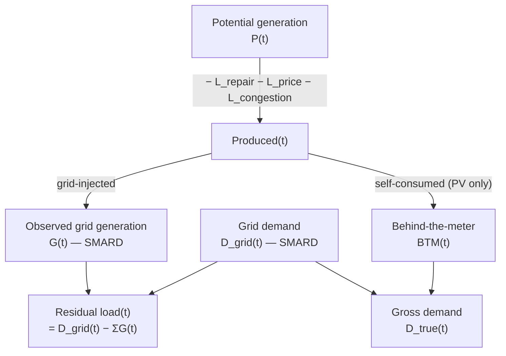

# Walkthrough: estimating residual load

This page teaches the residual-load model built in notebooks 38-41 —
what problem it solves, how to picture it, and what actually came out of
fitting it. The full notation and the complete list of equations live on
a [separate reference page](curtailment_system_equations.md); this page
tells the story, in the order it's easiest to follow, and links to the
reference and to the notebooks for the details it skips.

## The problem, in one sentence

Residual load (demand minus renewable generation) drives prices, but
both halves of that subtraction are things we never directly observe:
**gross power demand** (grid-metered load, plus invisible
behind-the-meter self-consumption) and **renewable generation net of
curtailment** (what the weather could have produced, minus whatever grid
operators or market conditions stopped from reaching the grid). We only
ever see the *already-contaminated* versions of both.

## Step 1: look at the gap directly

Before building anything, it's worth just plotting potential generation
(this project's own PECD-methodology replication — see the wind and
solar workstreams above) against what SMARD actually recorded reaching
the grid.

**Wind first, deliberately** — not because it's a clean match, but
because it isolates one thing at a time:

```{figure} ../../output/images/41_wind_offshore_potential_vs_observed.png
:name: fig-walkthrough-wind-gap
Wind offshore, Nov-Dec 2023: potential (this project's replication) vs. observed (SMARD).
```

**This still is not apples-to-apples.** The gap here is real and
substantial — it opens up specifically during the high-output stretches
where potential flattens out near the fleet's ceiling, while observed
generation stays well below it. Wind has no behind-the-meter
self-consumption to blur the picture, so whatever gap remains is (almost)
entirely curtailment plus a small amount of repair/model error — that's
what makes wind the *clean calibration signal* used below, not a
reassuring "these should match" chart. (Checked directly against real
curtailment and price data in
[notebook 48](../notebooks/48_analyse_offshore_gap_vs_curtailment.ipynb): this
"(almost) entirely loss" framing turns out to be too strong for offshore
wind specifically — real redispatch curtailment explains only ~40% of the
gap on average, and negative day-ahead prices, while a real and measurable
contributor on top of that, are far from the dominant piece either. A
sizeable share of the gap is more likely replication bias than an
unmeasured real loss.)

**PV's version of the same chart mixes in a second effect:**

```{figure} ../../output/images/41_pv_potential_vs_observed.png
:name: fig-walkthrough-pv-gap
Solar PV, Jun-Jul 2023: potential vs. observed (SMARD).
```

Every single day shows a gap at the peak, not just the high-oversupply
days the way wind did — consistent with self-consumption being a
*constant* companion to PV output, on top of the *episodic* curtailment
effect wind already showed. Separating those two is the rest of this
page.

## Step 2: the mental model



Read this left to right: potential splits into three loss streams and
whatever's actually produced; produced splits again into what reaches the
grid and what's used behind the meter; and that behind-the-meter piece
reappears on the demand side, combining with grid-metered demand into
gross demand. Residual load only ever sees the *grid* boxes — which is
exactly why `BTM` will turn out to cancel out of the final forecast
target later on, even though it has to be modeled correctly along the
way.

Putting real numbers on the PV side of that diagram:

```{figure} ../../output/images/41_pv_gap_decomposition.png
:name: fig-walkthrough-pv-decomposition
PV's average gap against SMARD, decomposed.
```

This is the headline surprise of the whole exercise: **curtailment, not
self-consumption, is the larger piece of PV's own gap** (76%) — not
obvious going in, since self-consumption is the effect that gets talked
about, and curtailment the one that was only checked directly here.

## Step 3: the equations that make this estimable

The full numbered list is on the
[reference page](curtailment_system_equations.md); the ones that matter
for the story:

- **The physical balance** (reference eq. 1-2): potential = losses +
  produced; produced = grid-injected + behind-the-meter.
- **The gross-demand regression** (eq. 7): `D_grid(t)` as a
  calendar/temperature model minus `k · P_pv(t)` — identified because
  `P_pv(t) = 0` at night and on heavily overcast days, pinning down the
  demand-model coefficients with zero self-consumption interference at
  all.
- **Two versions of the oversupply proxy** (eq. 8 vs. 9) — this contrast
  is worth its own moment. The naive one (built from *observed*
  generation and load) understates true oversupply exactly when
  curtailment is largest, since curtailment has already suppressed its
  numerator. The corrected one swaps in *potential* generation and
  *estimated gross* demand instead — built from things curtailment
  hasn't already touched.
- **The curtailment transfer** (eq. 10): fit a curtailment-rate-vs-
  oversupply curve on wind's clean gap, apply the same curve to PV.
- **The final target** (eq. 11): `BTM` cancels out, as promised by the
  flow diagram above.

## Step 4: evidence the method was actually tested, not just asserted

Three checks worth knowing about, because they're what earns trust in
the numbers above rather than just the numbers themselves:

- **Two built-in falsification checks, and both failed cleanly** —
  informatively, not fatally. A PV feed-in category that structurally
  cannot self-consume should show a zero coefficient; it didn't, and the
  reason turned out to be that its regressor correlates at 0.95 with the
  one that *should* show an effect, leaving too little independent
  variation for plain OLS to separate them. Wind potential, which has no
  self-consumption channel at all, also came back nonzero — but survived
  a direct test of the obvious alternative explanation (a much richer
  temperature response barely changed it), pointing instead at a real,
  different phenomenon: price-responsive industrial demand rising during
  cheap, high-wind hours. See [notebook 38](../notebooks/38_estimate_gross_demand.ipynb)
  for both in full.
- **Onshore and offshore wind were checked against each other**
  ([notebook 39](../notebooks/39_estimate_curtailment.ipynb)) — both
  structurally BTM-free, so if their curtailment-vs-oversupply shapes
  diverged sharply, the "one shared curve" transfer to PV would be too
  coarse. They agree from moderate oversupply upward, which is the range
  that actually matters for PV's own daylight hours.
- **The PV residual (curtailment already subtracted out) was checked
  against an independent series**: the self-consumption-registered
  capacity share from MaStR, which the model never sees during fitting.
  They correlate at 0.643 — supportive, though both simply trend upward
  over 2019-2025, so treat this as suggestive rather than a tight
  validated match.

## Step 5: the baseline, and what it's missing

The natural comparison is the forecast you'd get by skipping all of the
above:

| | Full model | Naive baseline |
|---|---|---|
| Demand side | `D̂_true(t)` — calendar + temperature, self-consumption backed out via `P_pv(t)` | `D_grid(t)` fit directly from calendar + temperature, no self-consumption term |
| Supply side | `P_total(t) − L̂(t)` — potential minus estimated curtailment | `P_total(t)` — raw potential, no curtailment correction |

## Step 6: does it actually work better?

Out-of-time — trained on 2019-2023, evaluated on 2024-2025, never seen
during fitting:

| Approach | MAE | Bias | Corr |
|---|---|---|---|
| Full model | 4,856 MW | -1,936 MW | 0.915 |
| Naive baseline | 10,560 MW | -9,750 MW | 0.905 |

```{figure} ../../output/images/40_scatter_vs_realized.png
:name: fig-walkthrough-backtest-scatter
Full model and naive baseline vs. realized residual load, out-of-time test period.
```

Roughly half the MAE, a quarter of the bias, only a modest correlation
gain — consistent with the demand and curtailment corrections fixing the
*level* far more than the day-to-day *pattern*, which both approaches
already track reasonably well from shared weather inputs.

**The caveat that belongs here, not in a footnote**: this backtest uses
*realized* historical weather, not a forecast. It measures how well the
model translates *known* weather and calendar information into residual
load — not genuine multi-day-ahead forecast skill. A real 5-15-day-ahead
deployment would feed this same pipeline with actual NWP forecast fields,
and forecast error (especially in wind speed timing beyond a few days)
would stack on top of everything measured here. This project's own
physical translation (GWA bias correction, per-plant power curves, the
technology-aware solar chain) is independently well-validated against
real generation, which is a good reason to expect it improves the
*translation* step of a forecast — but that's a different, narrower claim
than having tested actual multi-day forecast accuracy, which hasn't been
done.

One bug worth naming rather than quietly folding into the numbers above:
building the comparison in Step 7 below exposed that the curtailment
curve returned `NaN` for any out-of-time hour whose oversupply proxy fell
outside the training period's own range — 4.1% of the test period,
silently dropped rather than handled. Fixed in `pecdr/residual_load.py`
by clipping into the fitted range before lookup (the same
graceful-degradation an out-of-range value gets from a tree-based model
for free); every number on this page already reflects the fix.

## Step 7: does the structure actually earn its keep?

Step 6 answers "is the full model better than doing nothing." It doesn't
answer a sharper question: does explicitly modeling the *unobserved*
quantities (`D_true`, the curtailment curve) beat simply handing the same
*observed* weather-derived features to a model and letting it find its
own answer? [Notebook 42](../notebooks/42_compare_model_flexibility.ipynb)
adds four more points to the same out-of-time backtest to separate that
out:

```{figure} ../../output/images/42_mae_comparison.png
:name: fig-walkthrough-model-flexibility
Out-of-time MAE across six models, same test period.
```

| Model | What it uses | MAE | Corr |
|---|---|---|---|
| M0: calendar only | No weather at all | 10,284 MW | 0.486 |
| M1: naive baseline | Temperature + raw potential, no curtailment correction | 10,560 MW | 0.905 |
| M2: full structural | `D_true`, curtailment curve — the model taught above | 4,856 MW | 0.915 |
| M3: linear, features only | Same features as M2, one flat regression, no structure | 4,177 MW | 0.941 |
| M4: LightGBM, features only | Same features as M3, gradient-boosted trees | 6,714 MW | 0.921 |
| M5: LightGBM, capacity-rescaled | Same as M4, but capacity factors as features and a capacity-normalized target | 5,294 MW | 0.893 |

Four findings here are worth sitting with, because none of them is the
"obviously expected" result:

- **M0 vs. M1: weather information, used carelessly, is not obviously
  better than no weather information at all.** M1 has much better
  correlation than M0 (0.905 vs. 0.486 — it clearly tracks the pattern
  better), but its uncorrected curtailment assumption produces a bias so
  large that its *absolute* error ends up slightly worse than the
  calendar-only floor's.
- **M2 vs. M3: a plain linear regression, given the same inputs as the
  full structural model but none of its equations, does better.** Lower
  MAE, higher correlation. The most likely reason: M2's curtailment curve
  is fit on wind and *transferred* to PV under a shared-curve assumption,
  while M3's regression fits PV's own relationship to its own history
  directly, with no transfer step to be wrong about.
- **M3 vs. M4: more flexibility didn't help, for a specific, checked
  reason, not a mysterious one.** Installed capacity grew throughout
  2019-2025, so `years_since_start` has 100% of test-period rows beyond
  the training range and `P_wind_off_mw` has 20% — tree-based models
  cannot extrapolate a trend past what they saw in training, while a
  linear trend term does so by construction.
- **M4 vs. M5: rescaling by installed capacity helps, but doesn't fully
  fix it, and checking why turned up a second mechanism, not a dead end.**
  M5 (capacity factors as features, a capacity-normalized target,
  rescaled back to MW by multiplying by the actual, looked-up capacity at
  test time) cuts M4's MAE from 6,714 to 5,294 MW — the extrapolation
  story was real. But it still trails M3, because a different problem
  takes its place: M5's error in the *normalized* domain is tiny and
  essentially zero in-sample, but picks up a small (~0.006) out-of-sample
  bias on the test period — and multiplying that small bias back by
  `TotalCapacity_mw` to reconstruct MW **amplifies** it, precisely because
  capacity is largest late in the test period. Checked directly: the
  signed MW error correlates with `TotalCapacity_mw` at 0.44. Rescaling
  trades the tree's input-side extrapolation problem for a smaller
  output-side amplification problem — a real improvement, not a full fix.

**So which is it — features, or structure?** In this backtest, mostly
features: the biggest jump is M1→M2/M3 (weather-derived potential,
corrected for curtailment in *some* form), while M2→M3 shows the specific
hand-built structural form isn't what's earning that improvement, and a
simpler model given the same information does slightly better. That
doesn't make the structural work wasted — it's what made the
falsification checks, the wind/PV decomposition, and the equations page's
account of *why* the gap exists possible, none of which a flat regression
can offer — but as a pure point-forecast for residual load, the more
complex approach needed to earn its keep here, and on this specific test,
it didn't quite.

## What's still open

- The price-responsive-demand confound flagged in notebook 38.
- The un-detrended self-consumption cross-check in notebook 39 (year-over-year
  differences instead of levels would be a stronger test than the raw
  correlation).
- M5's own remaining gap: its out-of-sample bias in the normalized domain
  (~0.006) is small but not zero, and gets amplified on reconstruction to
  MW — worth understanding further (a rolling/expanding retraining
  scheme, discussed a few turns back, would keep that bias smaller by
  keeping the tree closer to the range it's asked to predict).
- Validating the curtailment estimate against real Redispatch 2.0 data
  (available from October 2021) — deliberately deferred; see the
  [reference page](curtailment_system_equations.md#what-real-congestion-data-can-and-cant-add)
  for why real congestion data can only validate an already-estimated
  model, never serve as a live forecasting input.
- Testing this pipeline against real NWP forecast data at 5-15-day
  lead times, to turn the "known-weather" backtest above into an actual
  forecast-skill measurement.
